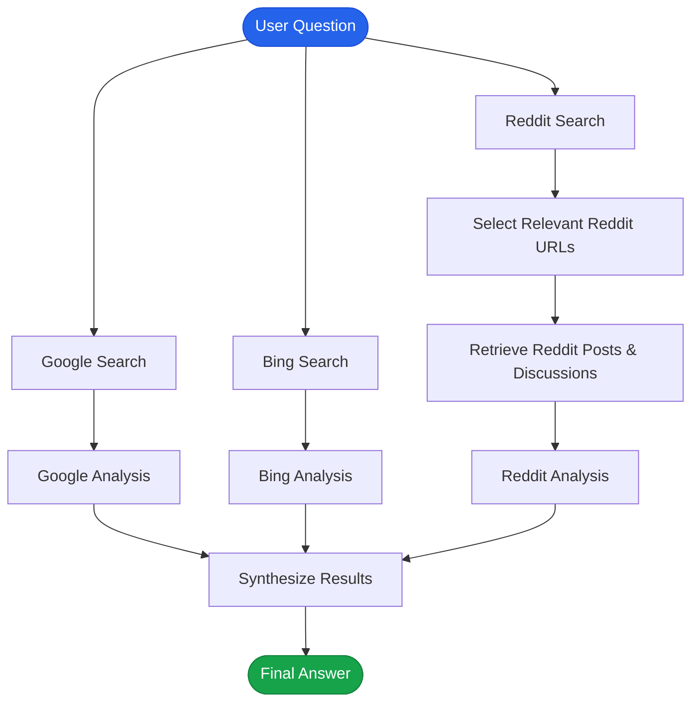

# langgraph-powered-autonomous-multi-source-research-agent
# LangGraph-Powered Multi-Source Research Agent

A Python research agent built with **LangGraph** that searches Google, Bing, and Reddit, processes the collected results, and uses an LLM to generate a final research answer.

The idea behind this project was to experiment with LangGraph's graph-based workflow, parallel execution, and the use of multiple sources to answer a single research question.

## How it works

The workflow starts with a user question. Three search operations run in parallel: Google, Bing, and Reddit.

The Reddit branch has an additional step: an LLM selects the most relevant Reddit URLs, then the agent retrieves the corresponding posts and discussions before analyzing them.

Once the data is collected, each source is analyzed separately. Their results are then passed to a final node, which combines the information into one answer.

## Workflow



## Tech stack

- **Python** – Main programming language.
- **LangGraph** – Workflow orchestration and parallel execution.
- **LangChain** – LLM integration.
- **Bright Data** – Search and data retrieval.
- **Ollama** – Running LLMs locally.
- **Pydantic** – Structured LLM outputs.
- **uv** – Python dependency and project management.

## Project structure

```text
.
├── main.py
├── web_operations.py
├── prompts.py
├── pyproject.toml
├── uv.lock
└── .env
```

## Getting started

### 1. Clone the repository

```bash
git clone https://github.com/wassimben2/langgraph-powered-autonomous-multi-source-research-agent.git
cd langgraph-powered-autonomous-multi-source-research-agent
```

### 2. Install dependencies

```bash
uv sync
```

### 3. Configure environment variables

Create a `.env` file and add your Bright Data credentials.

```env
# Add the environment variables required by web_operations.py
```

### 4. Set up Ollama

Install [Ollama](https://ollama.com/) and pull the model used by the project.

```bash
ollama pull qwen2.5:0.5b
```

You can change the model in the `ChatOllama` configuration in `main.py`.

### 5. Run the agent

```bash
uv run python main.py
```

## Things I want to improve

This is an ongoing project. Some things I'd like to explore next:

- Add a planning step so the agent can break down complex questions into smaller searches.
- Implement human-in-the-loop interactions to review research plans or request deeper research.
- Add long-term memory to retain information from previous research sessions.
- Improve source selection and relevance scoring.
- Add a fact-checking step to identify conflicting information.
- Experiment with more LLM providers.

---

**Built by [wassimben2](https://github.com/wassimben2)**
